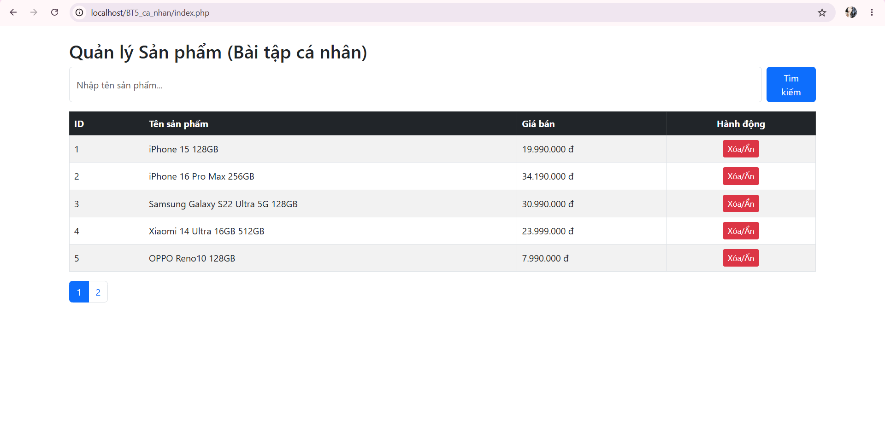
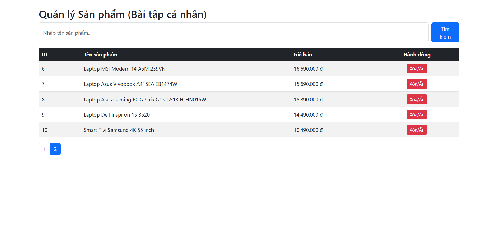

# BÀI TẬP CÁ NHÂN - NGUYỄN BẢO KHÁNH (TV2)
**Chức năng:** Hoàn thiện CRUD bảng `san_pham` (Xem, Tìm kiếm, Phân trang, Xóa/Ẩn).

## Route (Đường dẫn chạy)
- `http://localhost/BT5_ca_nhan/index.php`

## 5 Test Case Kiểm Thử
1. Test Case 1 (Xem danh sách & Phân trang):
Thao tác: Truy cập index.php. Bấm nút số 2 ở thanh phân trang.
Kết quả: Trang 1 hiện 5 sản phẩm, trang 2 hiện 5 sản phẩm tiếp theo.

2. Test Case 2 (Tìm kiếm):
Thao tác: Nhập "Laptop" vào ô tìm kiếm, bấm nút Tìm kiếm.
Kết quả: Chỉ hiển thị các sản phẩm có tên chứa chữ "Laptop".

3. Test Case 3 (Tìm kiếm không có kết quả):
Thao tác: Nhập "Tủ lạnh" vào ô tìm kiếm.
Kết quả: Hiện dòng chữ "Không có sản phẩm nào."

4. Test Case 4 (Xóa/Ẩn bằng POST):
Thao tác: Bấm nút "Xóa/Ẩn" ở một sản phẩm bất kỳ.
Kết quả: Hiện hộp thoại xác nhận. Bấm OK, sản phẩm biến mất khỏi danh sách.

5. Test Case 5 (Chống SQL Injection):
Thao tác: Nhập chuỗi ' OR '1'='1 vào ô tìm kiếm.
Kết quả: Hệ thống không bị lỗi, hiện "Không có sản phẩm nào" (Chứng minh Prepared Statement đã hoạt động, không bị hack)

## Hình ảnh minh chứng
 

